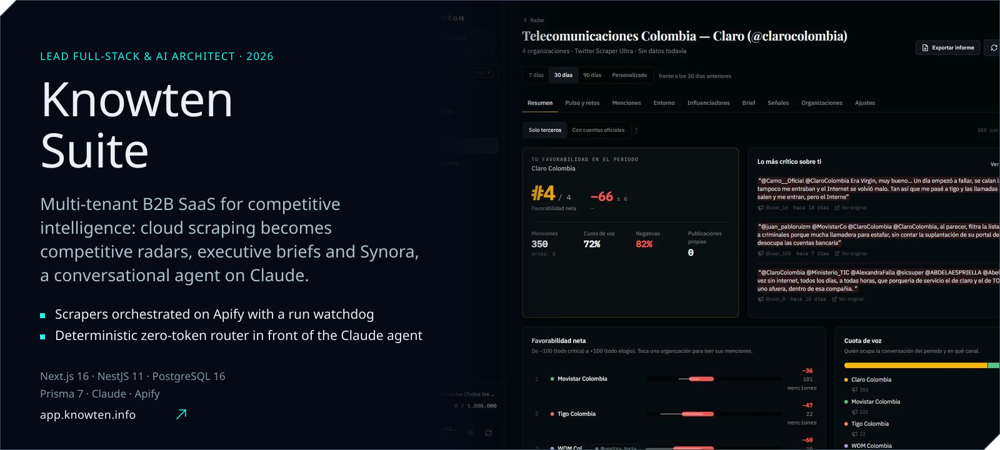
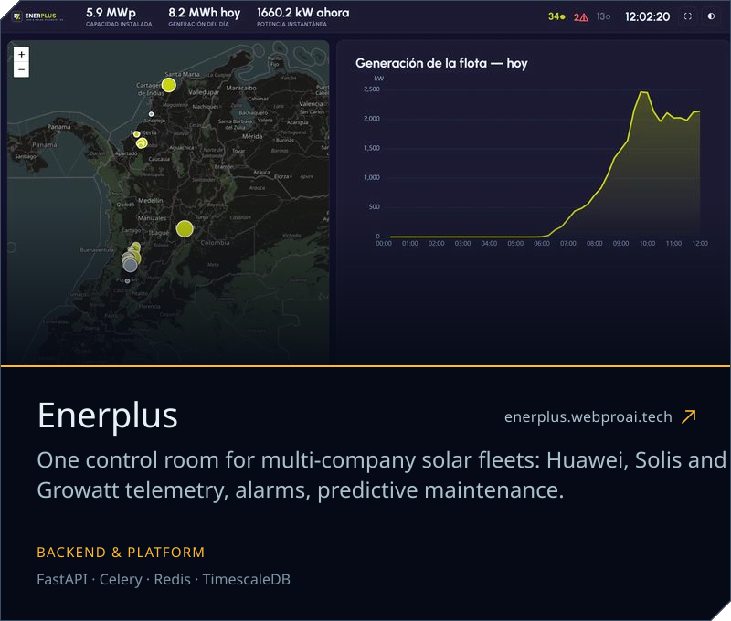
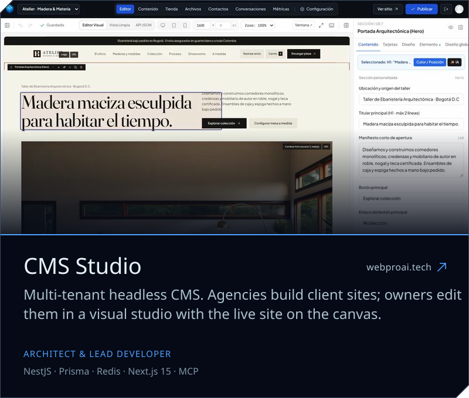
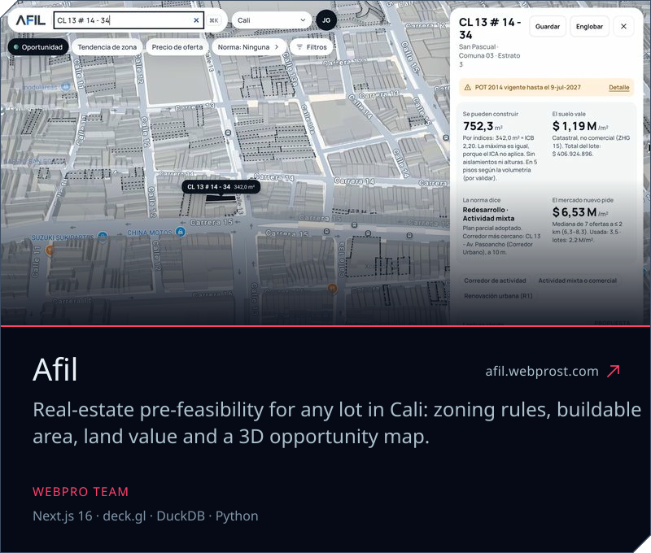
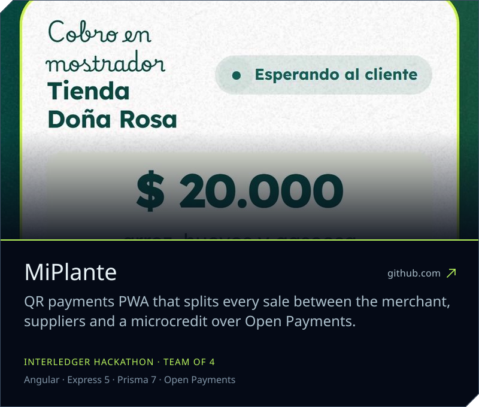

Full-stack software architect from Cali, Colombia, working remotely with teams in Naples, Florida. I design the backend, build the interface, and take AI agents and data platforms to production.

**[bzuluaga.site](https://bzuluaga.site)** · [LinkedIn](https://www.linkedin.com/in/brayanzz24) · [thezulux24@gmail.com](mailto:thezulux24@gmail.com) · [Apify Store](https://apify.com/knowten) · [CV (PDF)](https://bzuluaga.site/Brayan_Zuluaga_CV.pdf)

## Now

| Where | What I do | Since |
| :-- | :-- | :-- |
| **Axel Growth Partners** | Backend Developer & Software Architect. Secure, high-availability backends, infrastructure and AI agents for US clients. | Sep 2026 |
| **PROESA · Universidad Icesi** | Data Engineer, market intelligence. Eight HTTP-only retail scrapers for a World Bank study on tobacco and alcohol, with Gemini normalizing products. | May 2026 |
| **Knowten** | Lead Full-Stack & AI Architect. The whole SaaS, backend to interface: cloud extraction, competitive radars and the Synora agent. | Mar 2026 |

Before that: full-stack work for **P&P Camiones** (sales and operations platform, React + NestJS) and **Campus Nova** (clinical management and surgical traceability for Dentar and Implameq).

## Selected work

  
  

  
  

Also: [**Café Pa'l Monte**](https://github.com/thezulux24/scraper_wps_business), a Windows app that turns WhatsApp Business orders into receivables and reports (Electron, SQLite) · [**apify-http-scraper**](https://github.com/thezulux24/apify-http-scraper), a Claude Code skill for fast HTTP-only scrapers and Apify Actors.

## Stack

| | |
| :-- | :-- |
| **Backend & systems** | Rust · C · C++ · TypeScript · Python · NestJS · FastAPI · PostgreSQL · Redis |
| **Frontend & interfaces** | React · Next.js · Angular · Tailwind CSS · Three.js · GSAP · Electron · Flutter |
| **AI agents** | Claude · Gemini · tool calling · prompt caching · MCP |
| **Data & scraping** | Apify · Scrapling · curl_cffi · Playwright · Pandas · DuckDB |
| **Cloud & security** | Docker · Linux · Vercel · Coolify · Argon2id · HMAC |

## Activity

Most of my work lives in private client repositories, so the public graph shows only part of it.

---

Systems & Computer Engineering + Business Administration at Pontificia Universidad Javeriana Cali (2022–2027).
Open to remote full-stack, backend, architecture and AI roles, and to contract work: **[thezulux24@gmail.com](mailto:thezulux24@gmail.com)**
